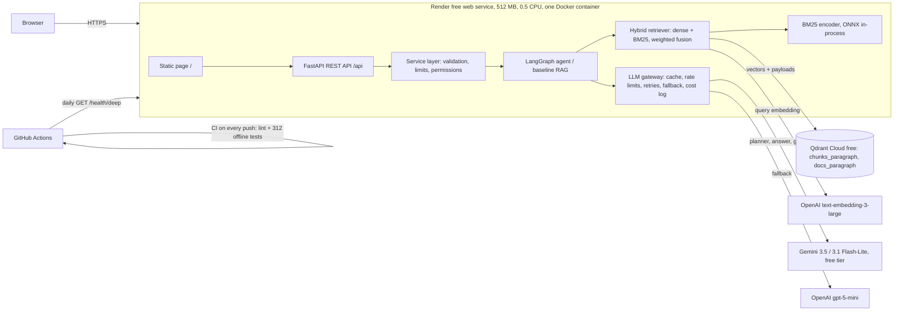

# Deployment

Live demo: **https://applied-ai-internship.onrender.com** · REST API docs: `/docs` · health: `/health`, `/health/deep`

Everything runs on free tiers; the only money spent is OpenAI usage (about $1.35 for the whole project so far, see [Costs](#costs)).

## Architecture

| Component | Where | What it holds |
|---|---|---|
| App (API + page) | Render free web service, Docker | Nothing persistent: stateless, safe to restart anywhere |
| Vectors, chunk text, document registry | Qdrant Cloud free cluster | `chunks_paragraph` (46,172 points, dense 1,536-d + BM25 sparse), `docs_paragraph` (registry) |
| Models in the image | Docker image (1.4 GB) | BM25 tokenizer/IDF model and the cross-encoder (ONNX); downloaded at build time so cold starts do not download |
| Secrets | Render environment variables; `.env` locally (git-ignored) | `GEMINI_API_KEY`, `OPENAI_API_KEY`, `QDRANT_URL`, `QDRANT_API_KEY`, `ADMIN_TOKEN` |
| Keep-alive | GitHub Actions cron (`.github/workflows/keepalive.yml`) | Daily `/health/deep`, a real Qdrant query |

**Request path (agent mode):** page → `POST /api/ask` → limiter → planner (Gemini, structured output) → `search_documents` tool calls → one hybrid search per round (OpenAI query embedding + BM25, weighted fusion in Qdrant results, hand-written) → grader decides whether to search again → claim extraction and contradiction check → answer with source labels → citation check and refusal rules (code) → JSON with answer, claims, cited and retrieved passages, warnings and the search trace.

## Persistence across restarts

Render's free disk is wiped on every restart, redeploy and spin-down, so the container keeps nothing it needs later:

- **Documents, chunks, vectors, registry:** in Qdrant Cloud. Uploads and deletions through the app go there directly.
- **Models:** baked into the image.
- **What is lost on restart (by design):** the LLM response cache (SQLite in `.cache/`), the JSONL call log and the in-memory rate-limit counters. Losing the cache only costs repeated LLM calls; the provider's own quotas still apply behind the in-memory counters.

## Free-tier limits and how the app lives with them

| Limit | Value (checked 2026-10-27/28) | Mitigation |
|---|---|---|
| Render RAM | 512 MB | Measured, then reduced (below). Running at ~210 MB. |
| Render CPU | ~0.5 vCPU | Reranker off in production; BM25 and fusion are cheap |
| Render spin-down | after 15 min without traffic; first request waits for a cold start | App itself starts in **6 s** (measured in a 0.5 CPU container); Render adds its own container start. Documented, not worked around. |
| Render hours | 750 instance-hours/month | One service; spun-down time does not count |
| Qdrant Cloud free | 0.5 vCPU, 1 GB RAM, 4 GB disk; paused after 1 week unused, deleted after 4 more | One collection set (~300 MB of vectors); daily keep-alive query |
| Gemini free tier | 15 requests/min, 500/day **per model** (AI Studio, 2026-10-27) | Planner/answer on 3.5 Flash-Lite, grader on 3.1 Flash-Lite (two quotas); client-side rate limiter; OpenAI fallback |
| Gemini latency | normally ~1 s; 15–50 s per call on 2026-10-28 | Not controllable; the page shows a "Thinking…" state; baseline mode is the fast path |
| OpenAI | paid per token | Daily total of 80 demo questions; per-visitor limits (3/min, 30/day); embeddings cached in Qdrant, LLM responses cached in SQLite |

### Memory: measured, then reduced

The first full image was killed for running out of memory on the first question. Measured inside a 512 MB / 0.5 CPU container against Qdrant Cloud:

| State | Idle | During questions |
|---|---|---|
| Gradio UI + reranker, fastembed default batch | 419 MB | OOM-killed |
| Static page, reranker off, batch 4, lazy parsers, `MALLOC_ARENA_MAX=2` | **206 MB** | **231 MB** after 6 questions (2 baseline, 4 agent) and a PDF upload |
| Live on Render (2026-10-28) | 205 MB | 210 MB after a question |

The single biggest cause was the cross-encoder scoring all 30 candidates in one batch padded to the longest passage (attention memory grows with batch × length²): 1,073 MB peak in isolation, 286 MB with batches of 4. Details and the trade-offs of turning the reranker off for the demo: `docs/DECISIONS.md`, D11 "Memory fix".

## Costs

Measured from the gateway's call log and the embedding token counts:

| Item | Tokens | Cost |
|---|---|---|
| Corpus embeddings, `text-embedding-3-small` (paragraphs + sentence windows, evaluation) | ~13.5 M | ~$0.27 |
| Corpus embeddings, `text-embedding-3-large` (production index; copied to the cloud, not re-embedded) | ~5.9 M | ~$0.77 |
| LLM calls, all evaluation runs (gpt-5-mini 508 calls, gpt-5-nano 263 calls) | ~0.9 M | ~$0.28 |
| Gemini (197 calls in evaluation) | ~0.23 M | $0 (free tier) |
| Render, Qdrant Cloud, GitHub Actions | — | $0 |

**Per demo question:** Gemini is free; a query embedding with `text-embedding-3-large` is ~20 tokens (~$0.000003). If Gemini fails and the gpt-5-mini fallback answers, an agent question costs roughly $0.004, so the worst case at the 80-questions/day cap is ~$0.30/day.

## Deploying from scratch (runbook)

1. **Qdrant Cloud:** create a free cluster; note its URL and API key.
2. **Index:** build the corpus (`scripts/build_dataset.py`), embed it into a local Qdrant (`scripts/index_corpus.py --strategy paragraph --embedder production --index-name paragraph__large --qdrant-url http://localhost:6333`), then copy it to the cloud without re-embedding: `scripts/copy_index_to_cloud.py --source paragraph__large`. (Indexing straight into the cloud also works: omit `--qdrant-url` and `--index-name`.)
3. **Render:** New → Web Service → this GitHub repo, branch `main`, language Docker, instance type Free, health check path `/health`; add the five environment variables. `render.yaml` records the same settings.
4. **Keep-alive:** GitHub → Settings → Secrets and variables → Actions → Variables: `APP_URL` = the Render URL; run the Keep-alive workflow once.
5. **Check:** `/health/deep` returns `{"status":"ok","qdrant":"ok"}`; ask a question on the page.

Redeploys happen automatically on every push to `main`. The app creates empty collections if the cluster has none, so it starts (and refuses questions) before data is loaded.

### When something is wrong

| Symptom | Likely cause | Fix |
|---|---|---|
| `/health/deep` returns 503 | Qdrant cluster paused (no use for a week) | Resume it in the Qdrant dashboard; check the keep-alive workflow ran |
| Answers say "temporarily unavailable" | Gemini quota or outage, and fallback failing | `/api/status` shows LLM calls; check OpenAI billing (an inactive account returns 429 "not active"; the gateway does not retry it) |
| 429 "daily question budget is used up" | Demo cap reached | Resets at UTC midnight; raise `app.limits` in `config/config.yaml` if needed |
| Deploy restarts in a loop | Memory | `/health` reports `rss_mb`; see the memory table above |
| Startup error "built with … expected …" | Collection embedded with another model than `embeddings.name` | Re-copy or re-index with the configured model |
| Need to rotate a key | — | Change it in Render's environment variables (redeploys) and in `.env` locally |
